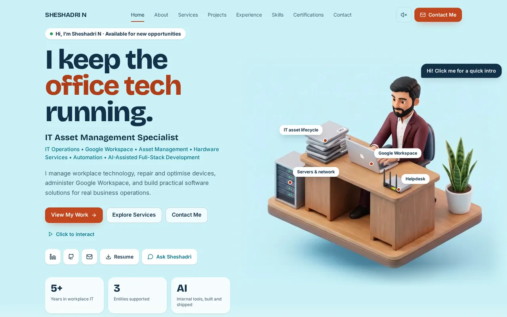
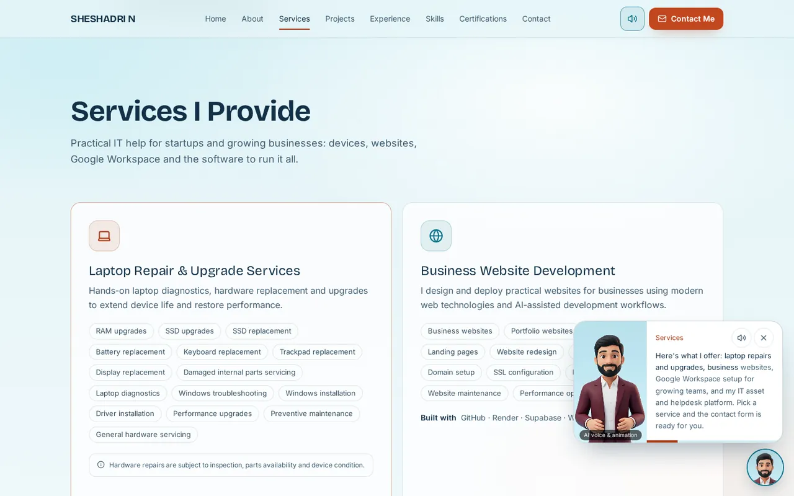
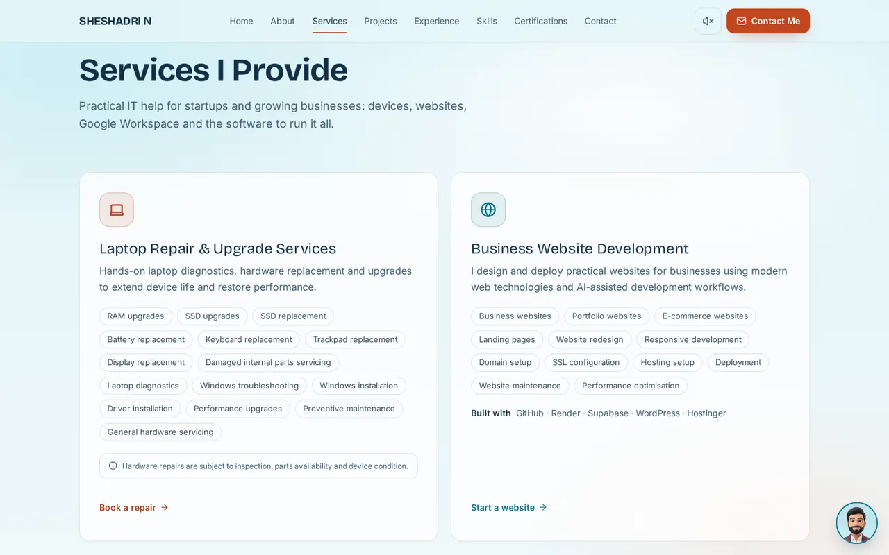
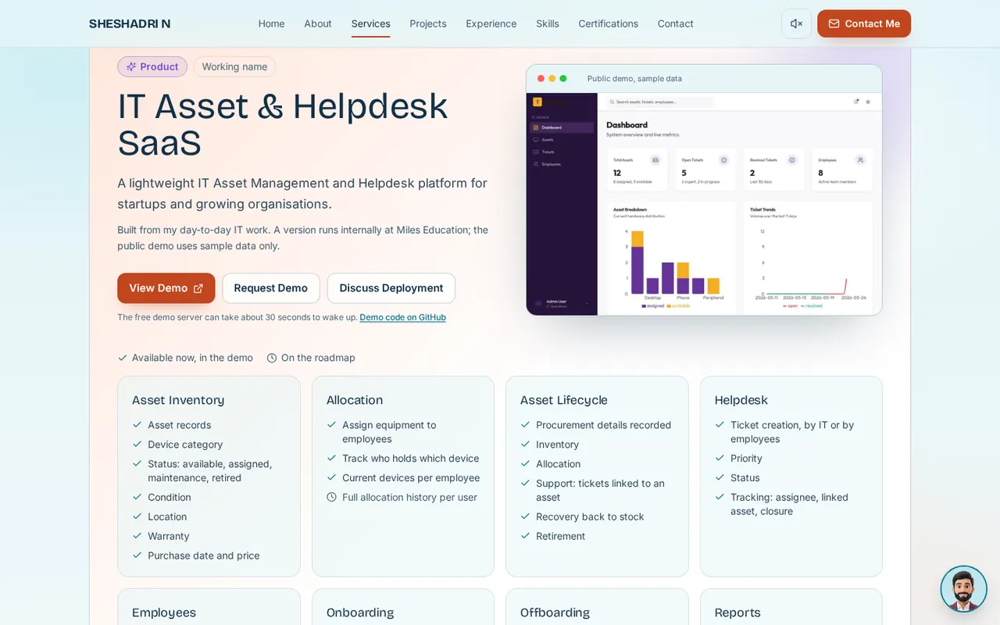
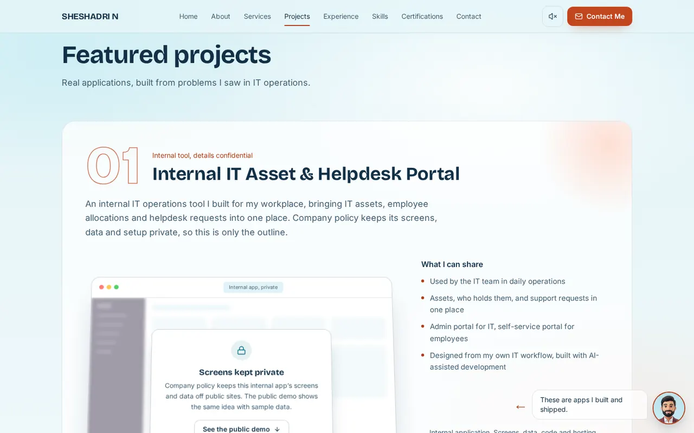
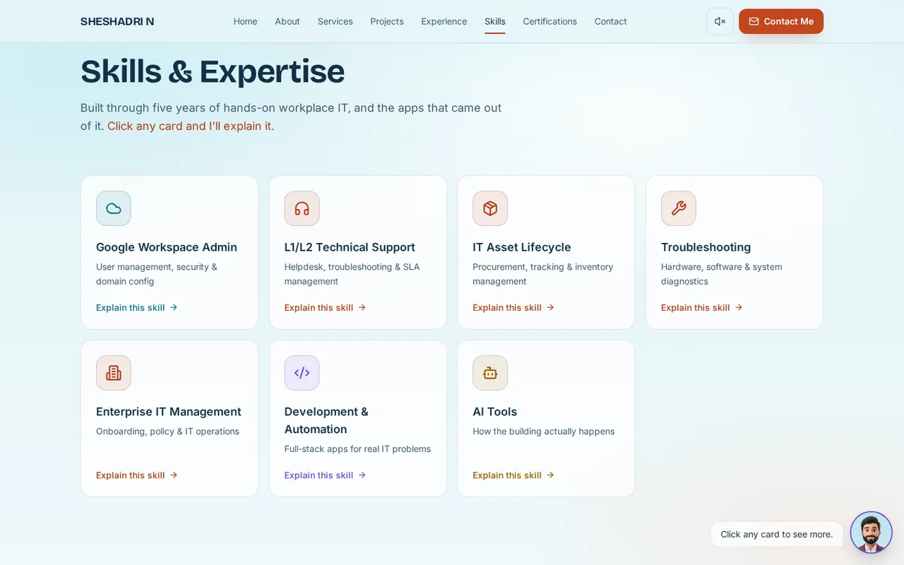
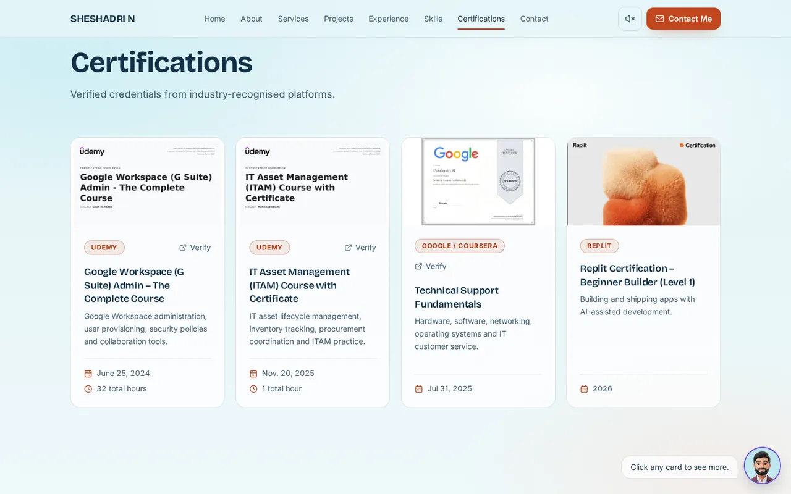
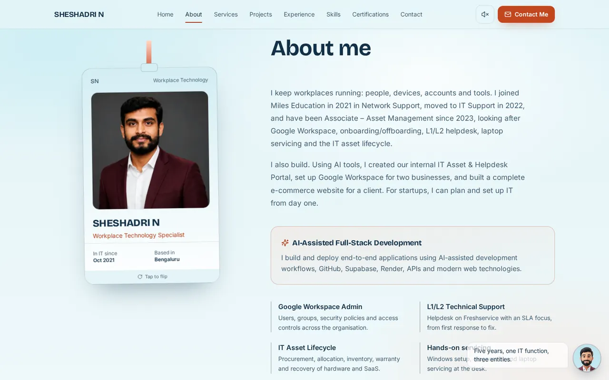
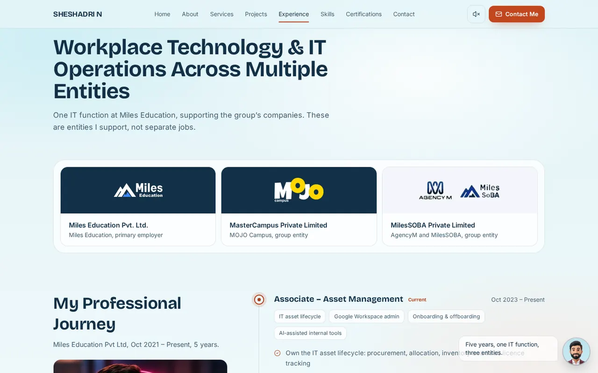
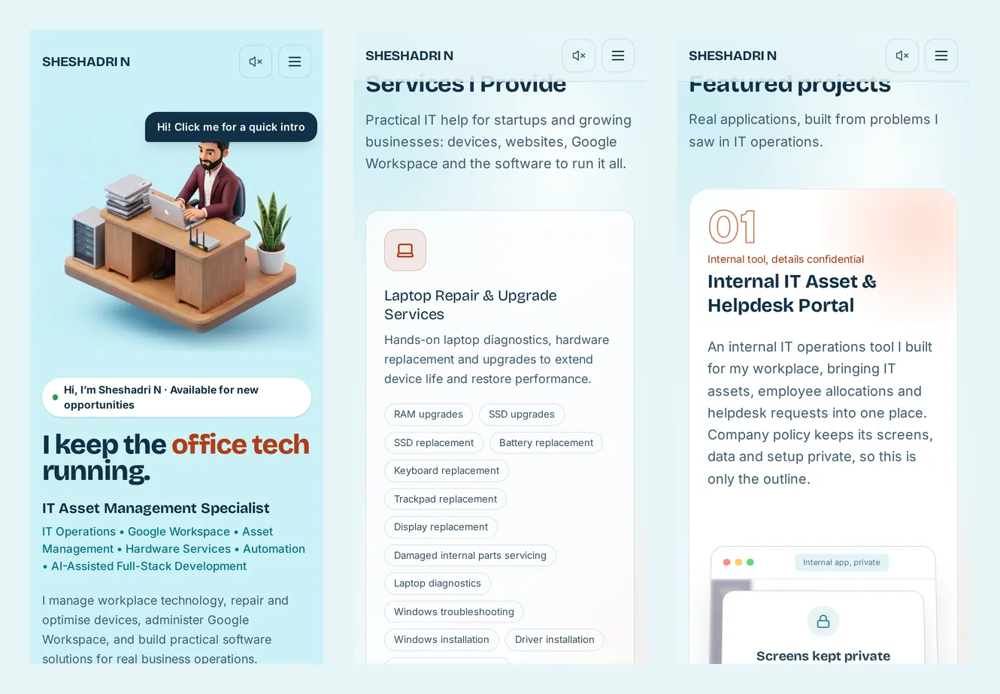

# Sheshadri N – Portfolio

Personal portfolio of **Sheshadri N**, Workplace Technology Specialist at Miles Education Pvt Ltd.

Live: [snscloud.in](https://snscloud.in) · LinkedIn: [sheshadri-n](https://www.linkedin.com/in/sheshadri-n) · GitHub: [sheshadri022](https://github.com/sheshadri022)

## Screenshots



| | |
|---|---|
|  |  |
| **3D guide** explains each section as you scroll or point | **Services** with a contact form that pre-selects the right option |
|  |  |
| **Product**: the public demo (sample data), what works in the demo and the SaaS features | **Projects**: the internal portal is shown as an outline only |
|  |  |
| **Skills**: click any card to have it explained | **Certifications** with verify links |
|  |  |
| **About** with the ID card | **Experience** across the group's companies |



## Stack

React 19, TypeScript, Vite 7, Tailwind CSS 4, Framer Motion, Lucide icons. Fonts are self-hosted through Fontsource (Syne, Inter, Caveat). Static site on Render, built from GitHub.

## Structure

```
src/
  data/profile.ts          every fact on the site (single source of truth)
  lib/ask.ts               Ask Sheshadri answer providers (local now, API-ready)
  context/VirtualHuman.tsx virtual human state: idle, greeting, explaining, projects, skills, contact
  hooks/useActiveSection.ts section tracking for the navbar and virtual human
  components/
    HeroSection, VirtualHuman, AskSheshadri, VirtualHumanDock
    AboutSection, EntityStrip, ExperienceTimeline
    FeaturedProjects, ProjectCaseStudy, DeveloperJourney, SkillsGrid
    Certifications, Education, ContactSection, Footer
    ResponsiveNavbar, AnimatedBackground, ResponsiveImage, SectionHeading
public/assets/
  profile/   photo variants (full, hero, about, avatar, mobile) in AVIF + WebP
  logos/     Miles Education, MOJO Campus, AgencyM, MilesSOBA
  projects/  public demo dashboard (sample data only) and screenshots of this site
docs/screenshots/  README pictures (not deployed)
  certs/     certificate images
```

To change content, edit `src/data/profile.ts`. Only verified facts go there.

### Years of experience update themselves

The "5+ years" figures are not typed anywhere. `src/lib/career.ts` holds the start date (`CAREER_START`, Oct 2021) and works out the whole years every time a visitor opens the page, so the hero stat, About intro, Experience line, Skills intro and the dock bubble move to 6, 7, and so on on each October anniversary, with no edit or redeploy. The talking guide's clips avoid year counts ("at Miles Education since 2021"), so they never go stale. The one place that does not update itself is `public/resume.pdf`, a fixed file: regenerate it when the count changes.

### Search engines

`index.html` carries what Google and Bing read first: the title "Sheshadri N | Workplace Technology Specialist, Bengaluru", a description, Person + WebSite + ProfilePage structured data (photo at `/sheshadri-n.jpg`, LinkedIn and GitHub in `sameAs`), and a plain-HTML summary of the profile inside `#root` that the React app replaces when it starts (it is also what visitors without JavaScript see). `public/sitemap.xml` and `public/robots.txt` point crawlers at the site. Ranking also needs Google Search Console and Bing Webmaster Tools set up for snscloud.in, and links to snscloud.in from LinkedIn and GitHub.

### Making any other change

Edit the file, commit and push to `main`. Render rebuilds and publishes snscloud.in automatically in a few minutes. Facts live in `src/data/` (`profile.ts`, `services.ts`, `skills.ts`, `voice.ts`); the components only display them.

## Run locally

```bash
npm install
npm run dev      # http://localhost:5173
npm run build    # outputs dist/
npm run preview  # serves dist/
```

## Ask Sheshadri and AI

Out of the box, answers come from `src/data/profile.ts` with no network calls. To connect a real model later:

1. Deploy a small server endpoint (Render web service or Supabase Edge Function) that accepts `POST { question }` and returns `{ text, links? }`. Keep the model API key there.
2. Set `VITE_ASK_ENDPOINT` to that URL in Render's environment settings and redeploy.

The browser only ever calls that endpoint. No API key is shipped in the frontend. If the endpoint fails, the local answers are used.

## Look: Template 03, Isometric IT Desk

Light sky-blue theme with deep navy text, a burnt-coral accent and teal for links and data; display font Bricolage Grotesque, body font Inter. Colours live as tokens in `src/index.css`.

## Services and product

- The internal IT Asset & Helpdesk Portal is confidential under company policy: the Projects section shows only an outline (no screenshots, data, code or hosting details) and points to the public demo. The public demo (sample data) appears once, in the Product block, with its code at github.com/sheshadri022/techops-demo-portal.

- Services I Provide (`src/data/services.ts`): Laptop Repair & Upgrade Services, Business Website Development, IT Asset & Helpdesk SaaS and Google Workspace & IT Setup. Each card's button jumps to Contact with "What do you need?" already picked.
- Product block (`#product`): the IT Asset & Helpdesk platform. "IT Asset & Helpdesk SaaS" is a working name, set once in `PRODUCT_NAME`. Module items are marked available only where the public demo's code has them (techops-demo-portal); everything else is shown as on the roadmap. The SaaS features block (multi-company, plans, roles, customer onboarding) is labelled "Built, in internal use": these exist in the internal version, not in the public demo.
- Laptop repairs carry the note "Hardware repairs are subject to inspection, parts availability and device condition." No manufacturer authorisation is claimed.

## Hero, ID card, skills and certifications

- Hero: a 3D isometric Sheshadri working at a floating desk with the things he looks after (laptops, server, router), labelled. The scene idles on a short silent loop (`public/assets/hero3d/`), its edges faded into the background. "I keep the office tech running.", the rotating titles, the business message and the CTAs sit on the left. The speech bubble ("Hi! Click me for a quick intro") or "Click to interact" has his 3D guide give a voiced intro.
- About: a flipping ID card on a lanyard (front: photo, name, title; back: what he does and how to reach him).
- Skills & Expertise: seven skill cards (`src/data/skills.ts`). Clicking a card opens a panel that explains the skill: a short summary, a step-by-step "How it works" narrated by an AI voice, and everything the skill covers.
- Certifications: a card grid with the certificate image (click to view it full size), platform, Verify link, what it covers, date and hours.

## Talking avatar and skill explainers

- Once the guide is started (speech bubble, Click to interact or the speaker button), it stays docked while you scroll: each section is explained once when you settle on it, and resting the mouse on a section explains that section (`src/components/GuideFollower.tsx`). It stays quiet while a skill or certificate dialog is open, and the X turns it off. Pointing at a menu item also explains that section. "Click to interact" in the hero, or the speaker button in the navbar, turns the voice on. Browsers block sound until the visitor clicks once, so before that clips play muted with captions.
- Poses: `public/assets/avatars/` holds his avatar set (id-front, seated, developer). Real-photo poses are used in About (ID card), Experience and Developer journey; the floating 3D guide changes its ring colour by section.
- Clips: `public/assets/avatar/*.webm|mp4` (intro, about, services, product, projects, journey, experience, education, skills, certifications, contact), lip-synced on a 3D character based on his photo with a neutral AI voice (Higgsfield: Seed Audio voice "Julian", Wan 2.7). Scripts live in `src/data/voice.ts`; change a script there and regenerate its clip.
- Skills: each card's panel plays a step-by-step explainer timed to an AI voice-over in `public/assets/voice/*.mp3`.
- Everything loads only when played, and the site labels the voice and animation as AI.

## Deployment (Render)

Render static site. Build command: `npm install && npm run build`. Publish directory: `./dist`. SPA rewrite to `/index.html` (`public/_redirects`). `dist/` is not committed; Render builds it on every push to `main`.

## Environment variables

| Name | Required | Purpose |
|------|----------|---------|
| `VITE_ASK_ENDPOINT` | No | URL of a server-side Ask endpoint. Leave unset to use local answers. |
